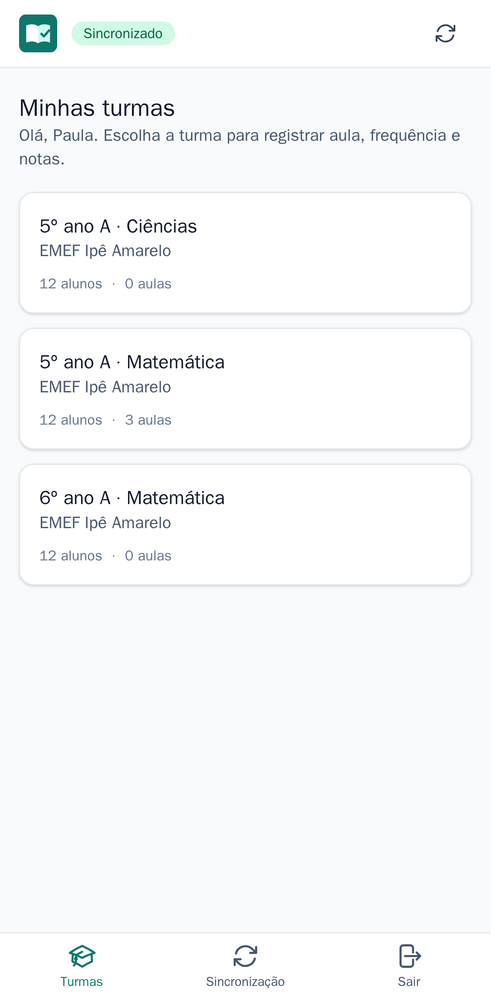
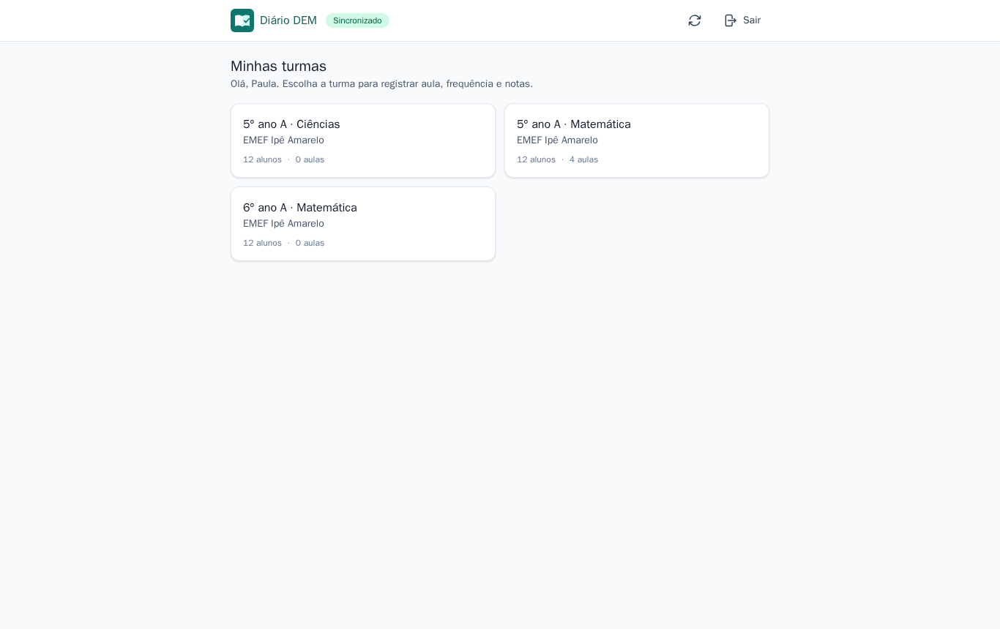
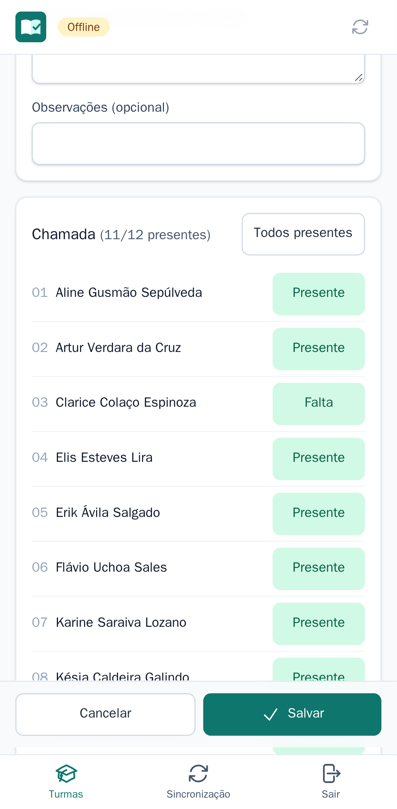
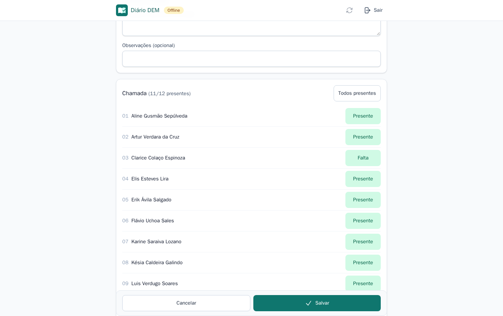
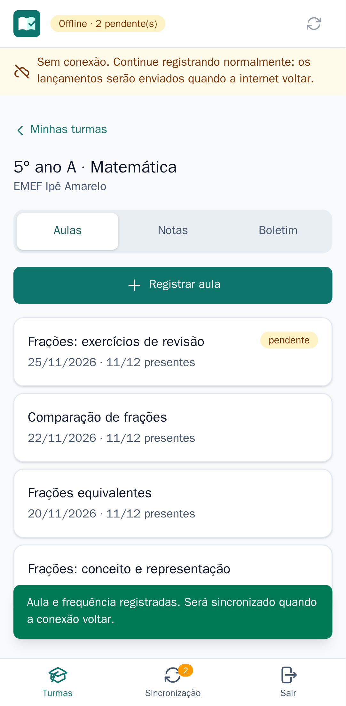
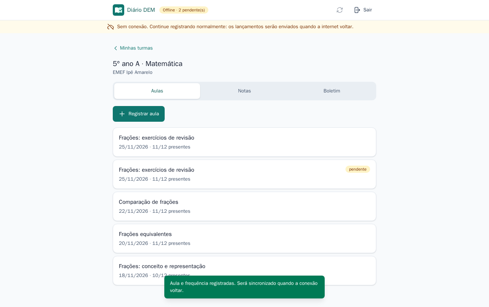
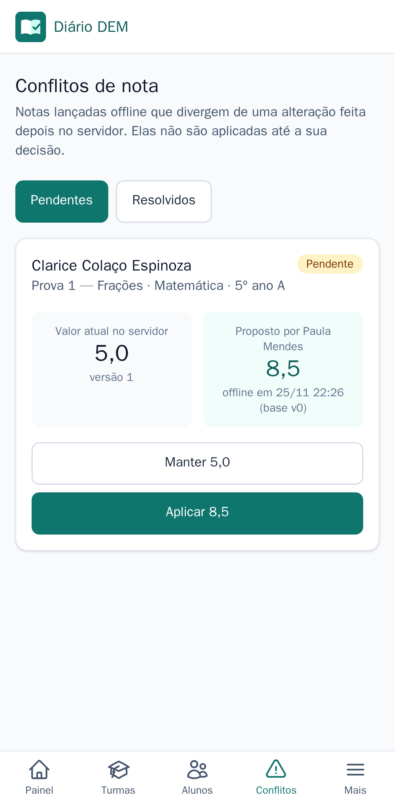
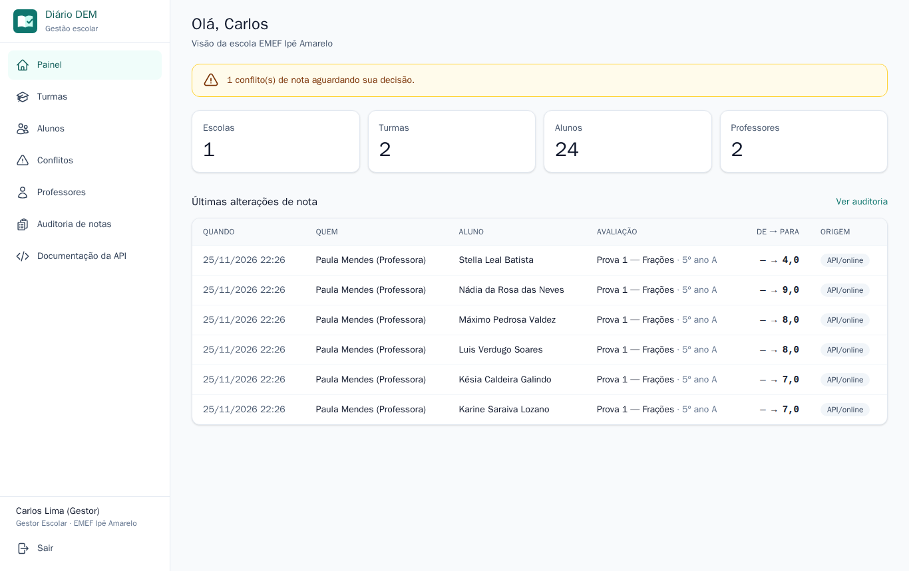

# Diário Escolar Municipal (DEM)

**Práticas Extensionistas IV** · Análise e Desenvolvimento de Sistemas · UNOESC
**Acadêmico:** João Vitor Bernardon Schweikart

PWA para escolas municipais do interior registrarem **aula, frequência e notas mesmo sem internet**.
Os lançamentos ficam numa fila local e são sincronizados com o servidor quando a conexão volta.

> A **Entrega 1** foi a modelagem arquitetural (`doc/Pratica Extensionista IV Modelagem Sistema PWA.pdf`).
> A **Entrega 2** é a implementação: aplicação web responsiva, PWA offline, API REST e infraestrutura
> em nuvem como código. A descrição da infraestrutura está em [`doc/infraestrutura.md`](doc/infraestrutura.md).

## O problema

A internet das escolas municipais do interior costuma ser instável ou inexistente justamente na sala de
aula. Na prática, o professor anota em papel e transcreve depois, com retrabalho, atraso e risco de erro.
O DEM resolve isso com uma PWA que funciona offline e sincroniza em lotes idempotentes quando a rede volta.

## O que foi entregue

| Critério (Entrega 2) | Onde está |
|---|---|
| **Responsividade** | Interface Blade + Tailwind *mobile-first*: tabelas viram cards no celular, alvos de toque ≥ 44 px, barra lateral no desktop e navegação inferior no celular ([prints](#prints)) |
| **PWA (versão mobile)** | Manifest instalável, service worker Workbox, app shell offline, fila no IndexedDB com UUID e versão, sincronização em lote (evento `online` + Background Sync), indicador de pendências e limpeza de cache/IndexedDB no logout |
| **API** | REST em `/api/v1` com Laravel Sanctum (tokens), API Resources, FormRequests, Policies, *rate limit*, OpenAPI (Scramble) e `GET /api/health` |
| **Infraestrutura** | AWS Lightsail `sa-east-1` (Docker Compose: nginx, php-fpm, mysql), ECR, SSM, CloudWatch, SES e bucket `dem-backups`; CI/CD no GitHub Actions com OIDC, aprovação manual e rollback ([doc/infraestrutura.md](doc/infraestrutura.md)) |

## Funcionalidades

- **Papéis:** Admin da Secretaria (toda a rede), Gestor Escolar (a própria escola) e Professor (somente
  as turmas/disciplinas em que está vinculado).
- **Cadastros:** escolas, professores e usuários, turmas, disciplinas, alunos, matrículas e vínculos
  professor↔turma/disciplina.
- **Diário:** aula (conteúdo) e chamada; avaliações com peso e bimestre; lançamento de notas; boletim com
  média ponderada, frequência e situação (padrão: média ≥ 6,0 e frequência ≥ 75%, conforme LDB art. 24, VI;
  valores configuráveis).
- **Offline (professor):** registra aula, frequência e nota sem conexão; recarregar a página offline
  funciona; a sincronização é automática quando a rede volta.
- **Sincronização no servidor:**
  - o UUID da operação é chave única, então reenviar o mesmo lote não duplica nada;
  - a versão do registro detecta conflitos;
  - aula e frequência resolvem conflito por *last-write-wins*;
  - **conflito de nota não é aplicado** e vai para a tela de conflitos do gestor.
- **Auditoria** imutável de toda alteração de nota (quem, quando, valor antigo e novo, origem).
- **Recuperação de senha** por e-mail (driver `log` em dev; Amazon SES via SMTP 587 em produção).

## Stack

Laravel 13 · PHP 8.5 · MySQL 8.4 · Blade + Alpine.js + Tailwind CSS 4 · Vite 8 · vite-plugin-pwa
(Workbox) · `idb` · Laravel Sanctum · Scramble · Pest 5 · Larastan · Pint · Playwright · Docker.

## Arquitetura

Monolito modular em camadas, com os mesmos pacotes da modelagem:

| Pacote (modelagem) | Código |
|---|---|
| `pwa.ui` | `app/resources/views`, `app/resources/js/app.js`, `app/resources/js/professor/` |
| `pwa.offline` | `app/resources/js/sw.js`, `app/resources/js/offline/` (IndexedDB, fila e sync) |
| `app.http` | `app/app/Http` (controllers, FormRequests, Resources, Policies) |
| `app.application` | `app/app/Application` (casos de uso: registrar aula/frequência, lançar nota, processar lote, resolver conflito, boletim) |
| `app.domain` | `app/app/Domain` (PHP puro: regras de média, frequência, acesso, resolução de conflitos e contratos) |
| `app.infrastructure` | `app/app/Infrastructure` (models e repositórios Eloquent, transação, notificações) |

O **domínio não depende de Laravel nem de Eloquent**: os contratos ficam em `App\Domain\*\Contracts` e
são ligados às implementações no `App\Providers\DomainServiceProvider`. Um **teste de arquitetura**
(`app/tests/Arch/ArquiteturaTest.php`) garante essa regra.

Diagramas: [pacotes](doc/diagramas/01-pacotes-arquitetura-aplicacao.png) ·
[implantação](doc/diagramas/02-implantacao.png) · [DevOps](doc/diagramas/03-devops.png).

## Como rodar localmente

Pré-requisito: Docker com Compose v2. Não é preciso ter PHP nem Node instalados.

```bash
git clone https://github.com/joaobschweikart/pwa-sistema-escolar.git
cd pwa-sistema-escolar
docker compose up -d
```

Na primeira subida o ambiente instala as dependências, compila o front-end, cria o banco `dem_db`, roda
as migrações e carrega os dados de demonstração (cerca de 2 a 4 minutos).

| Endereço | O que é |
|---|---|
| <http://localhost:8080> | aplicação (login) |
| <http://localhost:8080/professor> | PWA do professor |
| <http://localhost:8080/docs/api> | documentação da API (OpenAPI/Scramble) |
| <http://localhost:8080/api/health> | healthcheck |
| `127.0.0.1:3308` | MySQL local (usuário `dem`, senha `dem_dev_password`) |

As portas são configuráveis por variável: `DEM_HTTP_PORT=8081 DEM_DB_PORT=3309 docker compose up -d`.
Para recriar os dados de demonstração: `docker compose exec php-fpm php artisan migrate:fresh --seed`.
E-mails de recuperação de senha ficam em `app/storage/logs/laravel.log` (driver `log`).

### Credenciais de demonstração

Todas as contas usam a senha **`dem@2026`**. Os dados são fictícios.

| Papel | E-mail | Escopo |
|---|---|---|
| Admin da Secretaria | `admin@dem.local` | rede municipal inteira (2 escolas) |
| Gestor Escolar | `gestor@dem.local` | EMEF Ipê Amarelo |
| Gestora Escolar | `gestor2@dem.local` | EMEF Rio Bonito |
| Professora | `professor@dem.local` | 5º ano A (Matemática e Ciências), 6º ano A (Matemática) |
| Professor | `professor2@dem.local` | 5º e 6º ano A (Língua Portuguesa) |
| Professora | `professor3@dem.local` | EMEF Rio Bonito |

### Testar o modo offline

1. Entre como `professor@dem.local`. A PWA baixa as turmas e fica pronta para uso offline.
2. No DevTools do Chrome, abra **Network → Offline** (ou desligue o Wi-Fi).
3. Registre uma aula com a chamada e lance notas. O indicador mostra "Offline · N pendente(s)".
4. Recarregue a página: o app abre a partir do cache.
5. Volte a ficar online: os lançamentos sincronizam sozinhos. Como gestor, confira em **Auditoria**.
6. Para ver um conflito de nota: altere uma nota online, edite a mesma nota offline em outra aba ou
   aparelho com o valor antigo em cache e sincronize. O conflito aparece em **Conflitos** para o gestor.

No celular, abra o site em HTTPS e use **Adicionar à tela inicial** (ou o botão "Instalar").

## API

- Autenticação: `POST /api/v1/auth/token` com `{email, password, dispositivo}` → `Authorization: Bearer <token>`.
- Principais recursos: `escolas`, `turmas`, `alocacoes`, `aulas` (com `frequencia`), `avaliacoes` (com
  `notas`), `alocacoes/{id}/boletim`, `professor/dados` (snapshot offline), `sync`, `conflitos` e
  `auditoria/notas`.
- Documentação interativa em `/docs/api` e especificação em `/docs/api.json`.

```bash
TOKEN=$(curl -s -X POST localhost:8080/api/v1/auth/token -H 'Content-Type: application/json' \
  -d '{"email":"professor@dem.local","password":"dem@2026","dispositivo":"curl"}' | jq -r .token)
curl -s localhost:8080/api/v1/alocacoes -H "Authorization: Bearer $TOKEN" | jq
```

## Qualidade e testes

```bash
# Dentro do container (ou com PHP 8.5 local, a partir de app/)
docker compose exec php-fpm vendor/bin/pint --test        # estilo
docker compose exec php-fpm vendor/bin/phpstan analyse     # Larastan nível 7
docker compose exec php-fpm vendor/bin/pest                # 94 testes: unit, feature e arquitetura

# E2E Playwright (com o ambiente no ar), na imagem oficial do Playwright
cd app && npm run e2e:docker                               # desktop + celular (Pixel 7)
```

Cobertura relevante:

- unidade: média, frequência, situação, regras de acesso e resolvedor de conflitos;
- feature: idempotência do sync (mesmo lote 2× = 1 efeito), *last-write-wins*, conflito de nota e
  resolução, auditoria, policies (professor não acessa turma alheia) e todos os endpoints da API;
- E2E: login, **offline**, registro de aula/frequência/nota, **recarga offline**, sincronização
  conferida no banco, `start_url` offline, critérios de instalabilidade, limpeza no logout e viewport
  mobile.

## Estrutura do repositório

```
├── app/                     código Laravel (aplicação, API, PWA e testes)
├── doc/                     modelagem, diagramas, infraestrutura, prints e PDF da entrega
├── docker/                  configurações de PHP-FPM, nginx, MySQL e supervisord
├── infra/                   provisionamento AWS (aws/) e scripts do servidor (server/)
├── .github/workflows/       ci.yml e cd.yml
├── Dockerfile               imagem dem-app (multi-stage, linux/amd64)
├── docker-compose.yml       ambiente local (um comando)
└── docker-compose.prod.yml  produção: nginx, php-fpm e mysql
```

## Prints

| Celular | Desktop |
|---|---|
|  |  |
|  |  |
|  |  |
|  |  |

Mais telas em [`doc/prints/`](doc/prints/).
