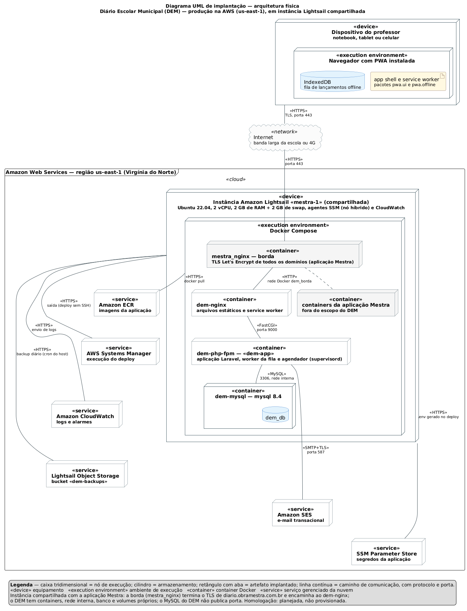
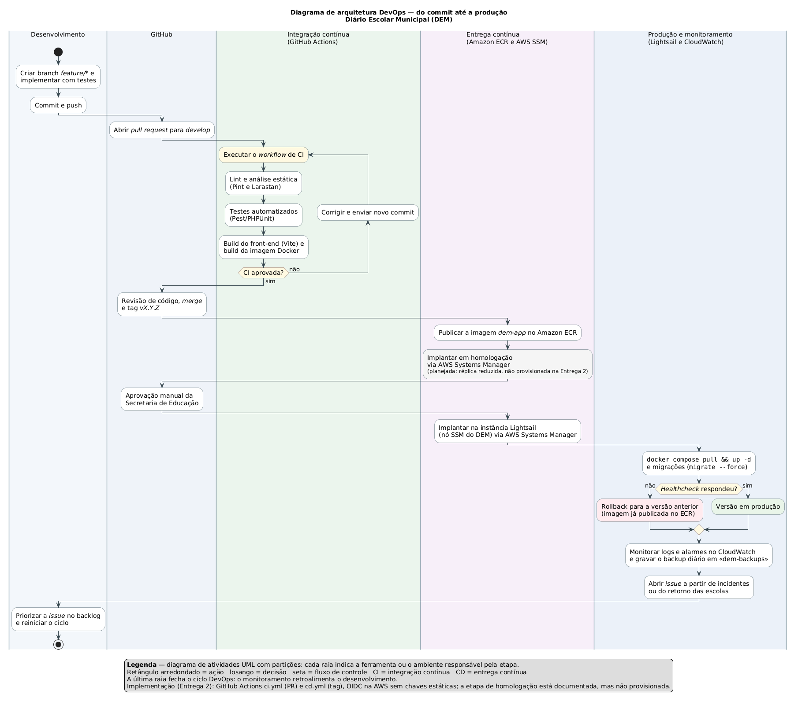

# Configuração da infraestrutura em nuvem — Diário Escolar Municipal (DEM)

**Práticas Extensionistas IV · Entrega 2** · Análise e Desenvolvimento de Sistemas · UNOESC
**Acadêmico:** João Vitor Bernardon Schweikart
**Repositório:** <https://github.com/joaobschweikart/pwa-sistema-escolar>

Este documento descreve a infraestrutura de produção do DEM como ela está **implementada no código**
deste repositório. Toda a infraestrutura é definida como código: o provisionamento usa AWS CLI
(`infra/aws/`), os servidores usam Docker Compose (`docker-compose.prod.yml`) e a entrega contínua
usa GitHub Actions (`.github/workflows/`). Os nomes de recursos seguem a modelagem aprovada
(`dem-app`, `dem_db`, `dem-backups`).

**Endereço de produção:** <https://diario.obramestra.com.br>

> **Configuração adotada nesta entrega:** por decisão de custo, o DEM roda numa instância Lightsail
> **já existente e compartilhada** com outra aplicação do autor (Mestra), na região `us-east-1`. A
> instância dedicada `dem-prod` em `sa-east-1`, prevista na modelagem, continua implementada nos
> scripts (`DEM_MODO=dedicado`) e é o caminho recomendado antes de receber dados reais (seção 1.1).



---

## 1. Resumo da solução

| Item | Configuração implantada |
|---|---|
| Provedor | Amazon Web Services (AWS), conta própria do autor |
| Região | `us-east-1` (Virgínia do Norte), zona `us-east-1a` |
| Modelo de serviço | IaaS simplificado (Amazon Lightsail) combinado com serviços gerenciados (PaaS/SaaS) |
| Computação | instância Lightsail **compartilhada** `mestra-1` (plano `small_3_0`): Ubuntu 22.04, 2 vCPU, 2 GB RAM + 2 GB de swap, 60 GB SSD, IP estático |
| Execução | Docker Compose com 3 containers do DEM: `dem-nginx`, `dem-php-fpm` (imagem `dem-app`) e `dem-mysql` (banco `dem_db`), atrás do nginx de borda da instância |
| Endereço | `https://diario.obramestra.com.br` (TLS Let's Encrypt) |
| Imagens | Amazon ECR, repositório `dem-app` (tags imutáveis) |
| Deploy | GitHub Actions → OIDC → ECR → aprovação manual → AWS Systems Manager (Run Command, nó híbrido) |
| Segredos | AWS Systems Manager Parameter Store (`SecureString`, `/dem/prod/*`) |
| Backup | `mysqldump` diário → Lightsail Object Storage `dem-backups` (retenção de 30 dias) |
| E-mail | Amazon SES via SMTP (porta 587, STARTTLS), identidade `diario.obramestra.com.br` |
| Monitoramento | Amazon CloudWatch (logs dos containers do DEM e métricas do agente), alarmes e AWS Budgets |
| Memória do DEM | tetos de 32 + 256 + 320 MB; uso real medido de ~290 MB |
| Custo adicional do DEM | cerca de **US$ 2 a 4 por mês** (a instância já era paga); instância dedicada: ~US$ 15 a 17 (seção 10) |
| Objetivos de recuperação | **RTO de 4 h** e **RPO de 24 h** |

Escopo desta entrega: provisionamos **somente produção**. A homologação está documentada como réplica
reduzida (seção 12), mas não foi criada.

### 1.1 Decisão: instância compartilhada (desvio justificado da modelagem)

A modelagem previa uma instância dedicada `dem-prod` em `sa-east-1`. Na implantação, o autor optou por
reaproveitar a instância Lightsail de 2 GB que já hospeda outra aplicação dele, porque o DEM é um
projeto acadêmico e uma segunda instância dobraria o custo sem ganho para a avaliação.

| Aspecto | Instância dedicada (modelagem) | Instância compartilhada (implantada) |
|---|---|---|
| Custo mensal | ~US$ 15 a 17 | ~US$ 2 a 4 adicionais |
| Região | `sa-east-1` (dados no Brasil) | `us-east-1` (região da instância existente) |
| Isolamento | nó exclusivo | containers, redes, banco, volumes e limites de memória próprios; mesmo kernel e host |
| TLS e portas | nginx do DEM em 80/443 | nginx de borda da outra aplicação termina o TLS e encaminha ao DEM |
| Acesso administrativo | sem SSH (só SSM) | o DEM usa só SSM; a porta 22 continua aberta porque a outra aplicação a usa |

Como o risco foi mitigado:
- **Isolamento de execução:** o DEM não compartilha banco, volumes nem redes internas com a outra
  aplicação. O único ponto de contato é a rede `dem_borda`, onde a borda alcança apenas o `dem-nginx`.
- **Falhas não se propagam:** o proxy da borda resolve o DEM em tempo de execução. Se o DEM cair, só
  `diario.obramestra.com.br` responde 502, e a outra aplicação segue no ar. O inverso também vale,
  porque os deploys são independentes.
- **Memória:** limites por container, php-fpm sob demanda e swap de 2 GB criado para proteger as duas
  aplicações de falta de memória.
- **Reversível:** `DEM_MODO=dedicado` cria a instância `dem-prod` e o deploy passa a usar o override
  `docker-compose.prod.dedicado.yml`, sem mudar a aplicação. **Antes de inserir dados reais de alunos,
  recomenda-se migrar para a instância dedicada em `sa-east-1`** (LGPD, seção 6.2).

## 2. Modelo de serviço: IaaS, PaaS e SaaS

A solução combina os três modelos de serviço, cada um onde ele faz mais sentido.

| Camada | Serviço | Modelo | O que fica com a equipe do município |
|---|---|---|---|
| Servidor da aplicação | Amazon Lightsail (instância) | **IaaS** | SO, Docker, containers, atualizações e backup do banco |
| Registro de imagens | Amazon ECR | PaaS | somente as imagens publicadas |
| Execução remota do deploy | AWS Systems Manager | PaaS | os scripts de deploy |
| Segredos | SSM Parameter Store | PaaS | os valores dos parâmetros |
| Armazenamento de backups | Lightsail Object Storage (S3) | PaaS | política de retenção |
| E-mail transacional | Amazon SES | PaaS/SaaS | domínio e conteúdo dos e-mails |
| Logs, métricas e alarmes | Amazon CloudWatch, Budgets | SaaS | limites e destinatários dos alertas |
| Código e CI/CD | GitHub e GitHub Actions | SaaS | workflows e revisões |
| Produto final | DEM para as escolas | **SaaS** do ponto de vista da Secretaria e das escolas | — |

### Por que Lightsail (IaaS) e não EC2 + RDS, Fargate ou Beanstalk

Para uma secretaria municipal de pequeno porte, o fator decisivo é **custo previsível e baixo esforço
de operação**, não o desempenho de pico (capítulo 6 da modelagem).

- **Preço fixo mensal** com transferência de dados, IP estático, DNS e firewall incluídos no mesmo console.
- **Carga modesta e concentrada:** até 30 escolas, 400 professores e 9.000 alunos por município. Uma
  instância de 2 GB atende com folga (seção 11).
- A **PWA funciona offline**, então uma indisponibilidade do servidor adia a sincronização, mas não
  impede o registro em sala. Isso torna aceitável um único nó, sem alta disponibilidade nativa.
- **Alternativas descartadas:**
  - **EC2 + RDS + ALB**: exige VPC, sub-redes e grupos de segurança, com custo mínimo maior (só um RDS
    gerenciado já supera o custo total previsto).
  - **ECS/Fargate**: elasticidade que a carga não exige, cobrança por vCPU/hora e um load balancer pago.
  - **Elastic Beanstalk / App Runner**: menos controle sobre o MySQL local e custo maior.
  - **Servidor na própria escola (self-hosted)**: é exatamente o que falha hoje (energia, internet e
    manutenção). Não oferece backup externo nem TLS público confiável.
- **Caminho de saída:** a AWS permite exportar snapshots do Lightsail para o EC2. A migração não exige
  reescrever a aplicação (seção 11).

O banco roda em container na própria instância, com **custo adicional zero**, latência desprezível e
o ambiente local idêntico ao de produção. O lado negativo é que o risco fica concentrado em um nó e o
backup fica sob responsabilidade da equipe. Isso é tratado nas seções 8 e 9. O banco gerenciado do
Lightsail parte de US$ 15/mês, o que dobraria o custo sem ganho perceptível para este volume.

---

## 3. Região: `us-east-1` (implantada) e `sa-east-1` (recomendada para dados reais)

- **Implantada: `us-east-1` (Virgínia do Norte).** É a região onde já estava a instância compartilhada.
  Todos os recursos de apoio (ECR, SSM, Parameter Store, SES, CloudWatch, bucket) foram criados na mesma
  região, o que evita tráfego entre regiões.
- **Latência:** a ida e volta Brasil–Virgínia acrescenta cerca de 120 a 150 ms por requisição. Para o
  DEM isso é pouco relevante, porque o professor trabalha offline e a sincronização é em lote.
- **Residência de dados:** com `us-east-1` os dados ficam nos EUA. Isso é aceitável para a validação
  acadêmica com **dados fictícios**, mas não para dados reais de crianças e adolescentes. Para uso real,
  a recomendação da modelagem continua valendo: `sa-east-1` (São Paulo), com os mesmos scripts
  (`AWS_REGION=sa-east-1`, `DEM_MODO=dedicado`).

A região é um parâmetro (`AWS_REGION` em `infra/config.env`), assim como a conta, o domínio e o modo.

## 4. Recursos e configurações

### 4.1 Instância Lightsail (compartilhada)

| Configuração | Valor |
|---|---|
| Instância | `mestra-1`, plano `small_3_0`: 2 vCPU, 2 GB RAM, 60 GB SSD, 3 TB de transferência/mês |
| Sistema | Ubuntu 22.04 LTS |
| Memória | **swap de 2 GB** criado para o DEM (`vm.swappiness=10`) |
| IP | IP estático `mestra-ip` (34.224.235.161); DNS `diario.obramestra.com.br` (Registro.br) aponta para ele |
| Firewall | regras da aplicação dona da instância (22, 80, 443); o DEM **não publica nenhuma porta** |
| Agentes | SSM (snap) registrado por **ativação híbrida** como nó `mi-…` com a tag `Projeto=dem`; agente CloudWatch |
| Diretório do DEM | `/opt/dem` (permissão 700): compose, configurações, scripts e `.env` gerado no deploy |
| Preparação | `infra/server/preparar-vm-compartilhada.sh` (idempotente; não altera a outra aplicação) |

### 4.2 Containers (`docker-compose.prod.yml`)

| Container | Imagem | Função | Limite de memória | Rede |
|---|---|---|---|---|
| `mestra_nginx` (borda, da outra aplicação) | `nginx:alpine` | TLS de todos os domínios da instância; vhost `diario.obramestra.com.br` encaminha ao `dem-nginx` | — | `dem_borda` + rede própria |
| `dem-nginx` | `nginx:stable-alpine` | arquivos estáticos (Vite, service worker com `Service-Worker-Allowed: /`), gzip, cabeçalhos de segurança, FastCGI | 32 MB | `app` + `dem_borda` |
| `dem-php-fpm` | `dem-app:vX.Y.Z` (ECR) | Laravel 13 / PHP 8.5 sob **supervisord**: `php-fpm` + `queue:work` + `schedule:work` | 256 MB | `app` + `dados` |
| `dem-mysql` | `mysql:8.4` (LTS) | banco `dem_db` | 320 MB | **somente `dados`** (rede interna) |

- **Imagem `dem-app`** (`Dockerfile` multi-stage, `linux/amd64`): `base` (PHP-FPM + extensões) →
  `vendor` (Composer sem dependências de desenvolvimento, autoload otimizado) → `assets` (build Vite +
  Workbox) → `prod` (supervisord, OPcache sem revalidação, healthcheck FastCGI `/ping`). A imagem também
  carrega os arquivos de implantação (`/opt/dem-deploy`), então **o artefato versionado é um só**.
- **Memória enxuta, sem lentidão:**
  - PHP-FPM `pm=ondemand`, até 5 processos, encerrados após 20 s ociosos;
  - `memory_limit=192M` e OPcache de 64 MB;
  - worker da fila reciclado ao passar de 96 MB.
- **MySQL** (`docker/mysql/my.cnf`): `innodb_buffer_pool_size=128M` (sobra para o volume de um município),
  `max_connections=30`, `performance_schema=OFF`, `utf8mb4`.
- **Uso medido:** nginx ~11 MB, php-fpm ~117 MB e MySQL ~158 MB, cerca de 290 MB no total.
- **Logs:** driver `json-file` com rotação (3 × 10 MB). O agente CloudWatch coleta **somente** os logs dos
  containers do DEM, por links em `/var/log/dem/containers/`.
- **Healthchecks:** `dem-nginx` (`/api/health`), `dem-php-fpm` (FastCGI `/ping`) e `dem-mysql`
  (`mysqladmin ping`). Todos os containers usam `restart: unless-stopped`.

### 4.3 Serviços de apoio (todos em `us-east-1`)

| Recurso | Nome | Configuração |
|---|---|---|
| Amazon ECR | `dem-app` | tags **imutáveis**, *scan on push*, AES-256, ciclo de vida mantendo as 15 imagens mais recentes (o rollback é só uma troca de tag) |
| Lightsail Object Storage | `dem-backups` | plano de 5 GB, acesso **privado**, chave de acesso exclusiva do backup |
| SSM Parameter Store | `/dem/prod/*` | 26 parâmetros `SecureString` (KMS), camada padrão gratuita |
| IAM: role `dem-github-deploy` | — | assumida pelo GitHub Actions via **OIDC** (somente tags `v*` e environment `production`). Pode publicar só no repositório `dem-app` e enviar comandos SSM só a nós com a tag `Projeto=dem` |
| IAM: role `dem-ssm-hibrido` | — | função do nó híbrido: `AmazonSSMManagedInstanceCore`, `CloudWatchAgentServerPolicy`, leitura do ECR e leitura de `/dem/prod/*` |
| SSM | nó híbrido `mi-…` | registrado por ativação de uso único (24 h); o Lightsail não é EC2 e não tem *instance profile* |
| Amazon SES | `diario.obramestra.com.br` | identidade de domínio com DKIM; usuário SMTP `dem-ses-smtp` restrito a `ses:SendRawEmail` com remetente `*@diario.obramestra.com.br` |
| Certificado TLS | Let's Encrypt | emitido pelo `mestra_certbot` (desafio HTTP-01 por webroot) e renovado pelo laço `certbot renew` já existente |
| DNS | Registro.br | registro A `diario` → IP estático da instância; CNAMEs de DKIM do SES |
| CloudWatch | `/dem/prod/{containers,deploy,backup}` | retenção de 30/90/90 dias; métricas `DEM/Producao` (memória e disco) |
| AWS Budgets | `dem-mensal` | limite de US$ 20/mês; alertas em 80% do gasto real e 100% do previsto |

### 4.4 Configuração da aplicação em produção

O `.env` de produção **não existe no Git nem na imagem**. A cada deploy, `deploy.sh` gera
`/opt/dem/.env` (permissão 600) a partir do Parameter Store e acrescenta `APP_ENV=production`,
`APP_DEBUG=false`, `APP_URL=https://diario.obramestra.com.br`, `SESSION_SECURE_COOKIE=true` e a versão
implantada. Sessão, cache e fila usam o próprio MySQL (`database`), sem Redis, para economizar memória.
A aplicação confia nos cabeçalhos `X-Forwarded-*` vindos das redes Docker (borda), então gera URLs
`https` e aplica o *rate limit* pelo IP real do cliente.

## 5. Rede, portas e TLS

```
Dispositivo do professor ──HTTPS 443──▶ [Firewall Lightsail] ──▶ mestra_nginx (borda: TLS 1.2/1.3, HSTS)
                                                                   │ HTTP 80 (rede Docker "dem_borda")
                                                              dem-nginx
                                                                   │ FastCGI 9000 (rede "app")
                                         dem-php-fpm ──SMTP 587 (STARTTLS)──▶ Amazon SES
                                                                   │ MySQL 3306 (rede "dados", interna)
                                                              dem-mysql  (sem porta publicada, sem saída à internet)

Host ──HTTPS 443 (somente saída)──▶ SSM · ECR · CloudWatch · Parameter Store · bucket dem-backups
```

| Porta | Origem → destino | Uso |
|---|---|---|
| 443/TCP | internet → borda | aplicação, API e PWA (HTTPS) |
| 80/TCP | internet → borda | desafio ACME e redirecionamento 301 para HTTPS |
| 80/TCP | borda → `dem-nginx` | somente na rede Docker `dem_borda` (sem porta no host) |
| 9000/TCP | `dem-nginx` → `dem-php-fpm` | FastCGI, somente na rede Docker `app` |
| 3306/TCP | `dem-php-fpm` → `dem-mysql` | somente na rede Docker `dados` (`internal: true`) |
| 587/TCP | `dem-php-fpm` → SES | e-mail com STARTTLS |
| 443/TCP (saída) | host → AWS | agente SSM, ECR (pull), CloudWatch, Parameter Store, S3 (backup) |
| 22/TCP | — | aberta pela aplicação dona da instância. **O DEM não usa SSH**: o deploy e a operação vão pelo SSM |

**TLS:** o certificado de `diario.obramestra.com.br` é emitido pelo Let's Encrypt (HTTP-01) através do
container certbot da borda (`infra/server/bin/certificado-borda.sh`, executado pelo deploy). A renovação
usa o laço `certbot renew` existente, e o nginx de borda recarrega periodicamente. A configuração usa
TLS 1.2/1.3 e `Strict-Transport-Security`. O vhost de borda está versionado em `infra/borda/dem.conf` e
no repositório da outra aplicação. No modo dedicado, o próprio `dem-nginx` termina o TLS (template
`https.conf.template`, certbot no host).

## 6. Segurança e LGPD

### 6.1 Controles técnicos

- **Identidades e acesso à AWS:** MFA na conta raiz, usuário IAM para o dia a dia e roles de privilégio
  mínimo. **O GitHub não guarda chaves da AWS**, porque autentica por OIDC com escopo restrito às tags
  `v*` e ao environment `production`.
- **Chaves estáticas:** só existem duas, ambas inevitáveis e restritas. A credencial SMTP do SES (o
  protocolo SMTP exige usuário e senha) só envia e-mail do próprio domínio. A chave do bucket só acessa
  `dem-backups`. As duas ficam no Parameter Store.
- **Segredos:** guardados no Parameter Store como `SecureString`, criptografados com KMS. Os scripts nunca
  gravam segredos no Git: `infra/config.env` e `infra/out/` estão no `.gitignore`.
- **Superfície de ataque:** o DEM não publica portas; o banco fica em rede sem saída. O DEM não usa SSH,
  mas a instância compartilhada mantém a porta 22 da outra aplicação. Na instância dedicada, apenas
  80/443 ficam abertas.
- **Isolamento na instância compartilhada:** containers, redes internas, banco, volumes, usuário de banco
  e segredos exclusivos do DEM. O nó SSM e a role de deploy só alcançam recursos com a tag `Projeto=dem`.
- **Aplicação:**
  - autorização por papel (Admin da Secretaria, Gestor Escolar e Professor) e por vínculo
    professor↔turma/disciplina, com Policies e regras de domínio cobertas por testes;
  - senhas com bcrypt e redefinição por token que expira em 60 minutos;
  - *rate limit* de 120 req/min na API, 30 lotes de sync/min e 5 tentativas de login/min;
  - CSRF nas telas web, cookies de sessão `Secure`/`HttpOnly` e tokens Sanctum com validade de 30 dias,
    revogados no logout;
  - documentação da API (OpenAPI) pública, pois descreve endpoints sem expor dados.
- **Integridade das notas:** cada alteração gera um registro **imutável** de auditoria (quem, quando,
  valor anterior e novo, origem). Um conflito de nota nunca é aplicado automaticamente: a decisão é do
  gestor.
- **Dispositivo do professor:** o cache guarda somente as turmas do próprio professor. O IndexedDB e o
  Cache Storage são **apagados no logout** (verificado no teste E2E). Se outro professor entrar no mesmo
  aparelho, o cache de turmas do anterior é descartado.
- **Backups:** trafegam por HTTPS, ficam criptografados em repouso no S3, têm retenção de 30 dias e o
  arquivo leva um checksum SHA-256.

### 6.2 LGPD (Lei nº 13.709/2018)

- **Controlador:** Secretaria Municipal de Educação. **Operador:** a AWS, como provedora de nuvem.
  A Secretaria deve indicar um **encarregado (DPO)**.
- **Base legal:** execução de políticas públicas e cumprimento de obrigação legal pela administração
  pública (art. 7º, II e III; art. 23). Os dados de crianças e adolescentes são tratados no seu
  **melhor interesse** (art. 14), apenas para a finalidade escolar.
- **Minimização:** o sistema guarda somente o necessário ao diário: nome, data de nascimento, código do
  aluno, responsável, frequência e notas. Não há dados sensíveis de saúde nem biometria.
- **Residência:** nesta entrega, dados **fictícios** e backups ficam em `us-east-1`. Para dados reais, a
  implantação deve ir para `sa-east-1` (Brasil), em instância dedicada.
- **Segregação:** cada escola só enxerga seus dados, e cada professor só vê as próprias turmas.
- **Rastreabilidade:** auditoria de notas, logs de deploy e de backup no CloudWatch.
- **Ciclo de vida:** retenção de backups de 30 dias. A guarda de longo prazo do registro escolar segue a
  norma educacional e é feita pelo próprio banco.
- **Plano gratuito da AWS:** use-o somente na validação acadêmica. Antes de inserir dados reais de
  alunos, mude a conta para o plano pago (seção 10).

---

## 7. CI/CD



**Versionamento:** Git Flow simplificado. Branches `feature/*` saem de `develop` com commits
convencionais; a promoção para `main` acontece por *pull request*; a publicação é feita por tag
semântica `vX.Y.Z`.

### 7.1 Integração contínua (`.github/workflows/ci.yml`)

Roda em todo *pull request* para `develop` ou `main` (e em push para `develop`):

1. **Pint** (estilo de código), **Larastan nível 7** (análise estática) e **Pest** (testes de unidade,
   de feature e de arquitetura, com 94 testes);
2. **Build Vite + Workbox**, conferindo que o service worker e o manifest foram gerados;
3. **Build da imagem Docker** `dem-app` (target `prod`, `linux/amd64`, com cache);
4. **E2E Playwright**: sobe o ambiente com `docker compose up --wait` e roda os testes offline em desktop
   e celular.

Se alguma etapa falhar, o merge fica bloqueado. Configure a proteção de branch exigindo o CI.

### 7.2 Entrega contínua (`.github/workflows/cd.yml`)

Disparada por tag `vX.Y.Z`:

1. **OIDC → role `dem-github-deploy`** (sem chaves estáticas).
2. **Build e push** da imagem `dem-app:vX.Y.Z` no ECR, com a versão embutida (`APP_VERSION`).
3. **Environment `production` com aprovação manual.** O responsável da Secretaria aprova no GitHub,
   porque o sistema guarda registro acadêmico oficial.
4. **`aws ssm send-command` (AWS-RunShellScript)** na instância: `docker pull`, extração dos arquivos de
   implantação de dentro da imagem e execução de `infra/server/bin/deploy.sh vX.Y.Z`, que:
   - gera o `.env` a partir do Parameter Store;
   - roda **`docker compose pull && up -d --wait`**;
   - roda **`php artisan migrate --force`**;
   - faz o **healthcheck** em `/api/health`, conferindo `status=ok` e `versao=vX.Y.Z` (até 150 s);
   - se algo falhar, faz **rollback automático** para a tag anterior (a imagem antiga continua no ECR;
     não há novo build);
   - mantém, de forma idempotente, o cron de backup, a configuração do agente CloudWatch e o TLS.
5. **Healthcheck externo** em HTTPS pelo GitHub Actions. Se falhar, o workflow envia
   `deploy.sh --rollback` via SSM.

**Migrações:** são *forward-only* e devem ser compatíveis com a versão anterior (padrão
*expand/contract*), para que o rollback de imagem seja seguro.

---

## 8. Backup e recuperação (RTO 4 h / RPO 24 h)

| Camada | Mecanismo | Frequência | Retenção | Destino |
|---|---|---|---|---|
| Banco `dem_db` | `infra/server/bin/backup.sh`: `mysqldump --single-transaction` → gzip → SHA-256 | diário, 03:15 (cron em `/etc/cron.d/dem`) | 30 dias no bucket, 7 dias no disco | bucket `dem-backups` |
| Instância inteira | snapshot automático do Lightsail | opcional (na instância compartilhada depende do dono; no modo dedicado, ativado) | 7 snapshots | Lightsail |
| Aplicação | imagens imutáveis no ECR | a cada tag | 15 versões | ECR |
| Configuração | Parameter Store + código no Git | a cada alteração | histórico de versões | AWS / GitHub |
| Lançamentos offline | fila no IndexedDB do professor | até sincronizar | até o envio | dispositivo |

- **RPO de 24 h:** no pior caso perdem-se os lançamentos do dia que já tinham sincronizado. Na prática a
  perda é menor, porque o que ainda estava offline continua na fila dos aparelhos e é reenviado (os lotes
  são idempotentes).
- **Teste de restauração:**
  - `restore.sh --teste ultimo` restaura o último dump num banco temporário, compara as contagens das
    tabelas principais com produção e apaga o banco temporário;
  - roda **todo mês** pelo cron;
  - foi validado nesta entrega: contagens restauradas iguais às de produção em cerca de 2 s;
  - um alarme avisa se o backup diário não for concluído.

**Procedimento de recuperação (meta: 4 h)**

| Cenário | Ação | Tempo estimado |
|---|---|---|
| Container travado | `restart: unless-stopped` e healthchecks reiniciam automaticamente | minutos |
| Versão com defeito | rollback automático, ou `deploy.sh --rollback` via SSM | < 10 min |
| Banco corrompido | `restore.sh --producao ultimo` (pede confirmação) | < 30 min |
| Perda da instância compartilhada | 1) `02-provisionar.sh` com `DEM_MODO=dedicado` (cria `dem-prod` já registrado no SSM); 2) apontar o registro A de `diario` para o novo IP; 3) atualizar `SSM_INSTANCE_ID` e `DEM_MODO=dedicado` no GitHub; 4) rodar o workflow CD com a tag atual; 5) `restore.sh --producao ultimo` | 1 a 2 h |
| Indisponibilidade da região | o mesmo procedimento em outra região (`AWS_REGION`), restaurando o dump copiado do bucket | até 4 h |

Durante toda a recuperação **as aulas continuam sendo registradas offline**.

## 9. Monitoramento

| O que | Como | Alerta |
|---|---|---|
| Saúde da aplicação | `GET /api/health` (banco, versão, tempo) usado pelo Docker, pelo deploy e pelo CD | rollback automático; e-mail do GitHub em falha |
| CPU e *status check* da instância | alarmes nativos do Lightsail (`dem-instancia-cpu`, `dem-instancia-status`) | e-mail: CPU ≥ 80% por 15 min, falha de status |
| Memória e disco | agente CloudWatch (namespace `DEM/Producao`) | SNS por e-mail: disco ≥ 80%, memória ≥ 90% |
| Logs dos containers do DEM | CloudWatch Logs `/dem/prod/containers` (30 dias) | consulta no Logs Insights |
| Deploys e backups | `/dem/prod/deploy`, `/dem/prod/backup` (90 dias) | alarme "backup diário ausente" |
| Custos | AWS Budgets `dem-mensal` | e-mail em 80% (real) e 100% (previsto) |
| Erros funcionais | fila de conflitos e auditoria de notas no painel do gestor | indicador no painel |

Os alarmes são criados por `02-provisionar.sh` quando `ALERTA_EMAIL` está definido, e cada inscrição
precisa ser confirmada pelo e-mail recebido da AWS. Recomendação complementar sem custo: um monitor externo
de disponibilidade (por exemplo, UptimeRobot) apontado para `https://diario.obramestra.com.br/api/health`.
Incidentes e retornos das escolas viram *issues* no GitHub, o que fecha o ciclo DevOps da modelagem.

## 10. Custos (estimativa mensal)

| Item | Compartilhada (implantada) US$/mês | Dedicada (modelagem) US$/mês | Observação |
|---|---|---|---|
| Instância Lightsail 2 GB (IPv4) | 0,00 adicional | ~12,00 | na compartilhada, a instância já era paga pela outra aplicação |
| IP estático | 0,00 | 0,00 | gratuito enquanto anexado |
| Snapshots automáticos | 0,00 (não ativados para o DEM) | ~1,00 a 2,00 | US$ 0,05/GB-mês, incrementais |
| Bucket `dem-backups` (5 GB) | 1,00 | 1,00 | dumps compactados ocupam poucos MB |
| Amazon ECR | ~0,10 a 0,30 | ~0,10 a 0,30 | US$ 0,10/GB-mês; ciclo de vida limita a 15 imagens |
| CloudWatch | ~0,60 a 1,00 | ~0,60 a 1,00 | 2 métricas personalizadas, alarmes e poucos GB de log |
| SES | < 0,10 | < 0,10 | US$ 0,10 por mil e-mails (só recuperação de senha) |
| SSM (Run Command, ativação padrão, Parameter Store padrão) | 0,00 | 0,00 | camada gratuita |
| Domínio | 0,00 (subdomínio de domínio existente) | ~0,70 | ex.: `.com.br` no Registro.br, cerca de R$ 40/ano |
| **Total** | **~2 a 4** | **~15 a 17** | o orçamento `dem-mensal` alerta acima de US$ 20 |

**Plano gratuito:** contas AWS novas entram no *Free plan*, com créditos de boas-vindas válidos por até
6 meses e utilizáveis em serviços elegíveis, como o Lightsail. Ao fim do período, ou quando os créditos
acabam, a conta é **encerrada** se não for convertida para o plano pago. A conta usada aqui já opera no
plano pago, porque hospeda a outra aplicação. Recomendação para uma secretaria: configure o AWS Budgets
logo no início e use o plano pago antes de inserir dados reais. Confira as condições vigentes em
<https://aws.amazon.com/free/> e <https://aws.amazon.com/lightsail/pricing/>.

## 11. Escalabilidade e migração para EC2

**Capacidade atual:** no pico (início das aulas), 400 professores sincronizam lotes pequenos (dezenas de
operações, cerca de 50 a 300 ms cada). Mesmo que todos sincronizassem no mesmo minuto, seriam algumas
requisições por segundo, bem dentro de 12 processos PHP-FPM. Os dados de um município (9.000 alunos,
cerca de 200 dias letivos de frequência) somam poucos GB no MySQL.

A aplicação está pronta para escalar horizontalmente:

- **sem estado no servidor:** sessão, cache e fila ficam no banco, e os arquivos estáticos são
  versionados;
- **API idempotente:** reenvios de lotes são seguros.

**Degraus de crescimento:**

0. **Sair da instância compartilhada:** `DEM_MODO=dedicado` cria `dem-prod` (em `sa-east-1` para dados
   reais) e o mesmo pipeline passa a implantar lá (seção 8, "perda da instância").
1. **Vertical no Lightsail:** snapshot → nova instância de 4 ou 8 GB → mover o IP estático (minutos de
   janela, sem mudar o DNS).
2. **Separar o banco:** banco gerenciado do Lightsail ou Amazon RDS (MySQL 8), bastando alterar `DB_HOST`
   no Parameter Store. Isso traz backups automáticos e *Multi-AZ*.
3. **Migrar para EC2:** `aws lightsail export-snapshot` gera uma AMI/EBS no EC2. Depois:
   - **ALB** e **Auto Scaling Group** com a mesma imagem `dem-app`, ou **ECS**;
   - **RDS Multi-AZ**;
   - **CloudFront** para os estáticos e o service worker;
   - **ElastiCache/SQS** se a fila crescer.

   O pipeline continua o mesmo (OIDC, ECR, aprovação manual). Muda só o destino do deploy, que passa a
   ser o SSM em EC2 (o *instance profile* substitui a ativação híbrida) ou o ECS.
4. **Vários municípios:** uma instalação por município (isolamento de dados, como na modelagem) com os
   mesmos scripts parametrizados por `infra/config.env`.

---

## 12. Homologação (planejada, não provisionada)

Réplica reduzida da produção, descrita aqui para orientar a próxima etapa:

- instância Lightsail de 1 GB (`dem-hml`, cerca de US$ 7/mês), sem snapshots automáticos;
- mesmos scripts, com `DEM_INSTANCIA=dem-hml`, `DEM_SSM_PARAM_PATH=/dem/hml` e um subdomínio próprio;
- deploy automático a cada merge em `main`, como environment `staging` sem aprovação;
- dados fictícios (`DemoSeeder`), nunca dados reais de alunos.

O diagrama DevOps (`doc/diagramas/03-devops.puml`) marca essa etapa como planejada.

---

## 13. Como provisionar (resumo)

Pré-requisitos: AWS CLI v2 configurado, `jq`, `openssl` e `python3`. Copie
`infra/config.env.example` para `infra/config.env` e preencha a conta, a região, o domínio, o e-mail, o
repositório e o modo (`DEM_MODO`). Todos os scripts **pedem confirmação** antes de criar recursos e são
idempotentes.

```bash
cd infra/aws
./00-verificar.sh      # credenciais, conta, região e MFA da raiz
./01-orcamento.sh      # AWS Budgets
./02-provisionar.sh    # ECR, bucket, IAM/OIDC, ativação SSM (+ instância/IP/firewall no modo dedicado), alarmes
./03-dns.sh            # somente se o DNS estiver no Lightsail (aqui o DNS é do Registro.br)
./04-ses.sh            # identidade do domínio no SES + credencial SMTP
./05-segredos.sh       # Parameter Store (/dem/prod/*)
./06-ssm.sh status     # confere o nó híbrido (ID mi-...)
```

**Modo compartilhado (implantado):** depois do `02-provisionar.sh`, rode a preparação na instância
existente, com o código da ativação SSM gerado em `infra/out/ssm-ativacao.env`:

```bash
( set -a; . ../out/ssm-ativacao.env; set +a
  printf 'export AWS_REGION=us-east-1 SSM_ATIVACAO_ID=%q SSM_ATIVACAO_CODIGO=%q\n' "$SSM_ATIVACAO_ID" "$SSM_ATIVACAO_CODIGO"
  cat ../server/preparar-vm-compartilhada.sh ) | ssh <instância> 'sudo bash -s'
```

Em seguida, inclua o vhost `infra/borda/dem.conf` no nginx de borda e conecte esse nginx à rede externa
`dem_borda`.

Por fim, configure as *variables* do GitHub (`AWS_ROLE_ARN`, `AWS_REGION`, `ECR_REGISTRY`,
`SSM_INSTANCE_ID`, `DEM_DOMAIN`, `DEM_MODO`) e o environment `production` com revisor obrigatório, e
publique a tag: `git tag v1.0.0 && git push origin v1.0.0`.
